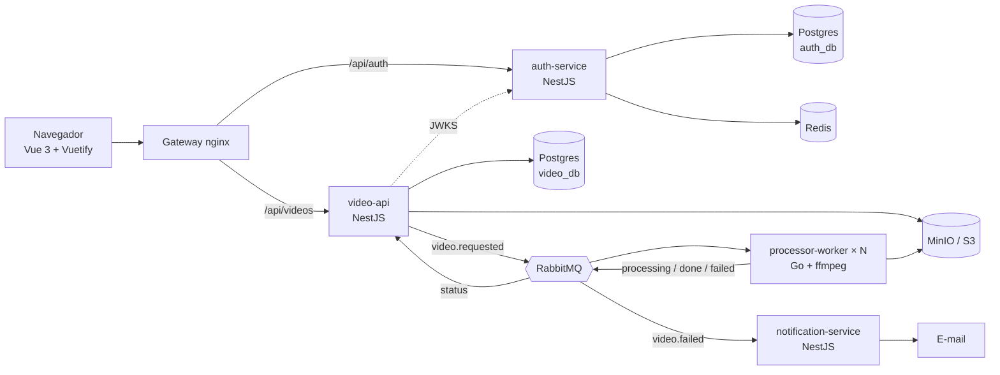

# FIAP X — Processador de Vídeos

Hackathon **SOAT — Fase 5 (FIAP Pós Tech)**. O usuário envia vídeos e baixa um `.zip` com os frames extraídos.

Esta versão reescreve o [projeto base](legacy/) com arquitetura de microsserviços e mensageria. A versão nova processa vários vídeos ao mesmo tempo, não perde requisições em picos, exige usuário e senha, lista o status dos vídeos de cada usuário e avisa por e-mail quando um processamento falha.

## Documentação

| Documento | Conteúdo |
|---|---|
| [docs/arquitetura.md](docs/arquitetura.md) | Requisitos × solução, diagramas C4, fluxos (login, upload, falha), mensageria, dados, escalabilidade, segurança, observabilidade, CI/CD |
| [docs/adr](docs/adr) | Decisões de arquitetura (monorepo, Go × NestJS, banco por serviço, outbox, RabbitMQ, S3, JWT, SQL puro) |
| [contracts](contracts) | Contratos HTTP (OpenAPI) e de mensagens (AsyncAPI) |
| [docs/apresentacao.md](docs/apresentacao.md) | Roteiro do vídeo e passo a passo da demonstração |

### Entregáveis do hackathon

- [x] **Documentação da arquitetura:** [docs/arquitetura.md](docs/arquitetura.md) + [ADRs](docs/adr)
- [x] **Script de criação do banco e dos demais recursos:**
  - [infra/db/init](infra/db/init/01-create-databases.sh): databases e usuários por serviço;
  - migrations [auth](services/auth/migrations/001_init.sql) e [video-api](services/video-api/migrations/001_init.sql), além do [schema consolidado](infra/db/schema.sql);
  - [filas do RabbitMQ](infra/rabbitmq/definitions.json) e [buckets](infra/minio/create-buckets.sh).
- [x] **Link do GitHub:** este repositório
- [ ] **Vídeo de até 10 minutos:** roteiro em [docs/apresentacao.md](docs/apresentacao.md)

## Arquitetura



| Serviço | Pasta | Stack | Status |
|---|---|---|---|
| auth-service | [services/auth](services/auth) | Node + NestJS | ✅ Implementado |
| video-api | [services/video-api](services/video-api) | Node + NestJS | ✅ Implementado |
| processor-worker | [services/processor](services/processor) | Go + ffmpeg | ✅ Implementado |
| notification-service | [services/notification](services/notification) | Node + NestJS | ✅ Implementado |
| frontend | [frontend](frontend) | Vue 3 + Vuetify | ✅ Implementado |

**Decisões principais**
- **Banco por serviço.** O worker não acessa banco: ele publica eventos de status e a video-api atualiza o próprio banco.
- **Outbox transacional + filas quorum + ack manual + retry/DLQ.** Nenhum upload aceito fica sem processamento.
- **JWT RS256.** Os serviços validam o token localmente pela chave pública (JWKS), sem chamar o auth a cada requisição.
- **Monorepo com serviços independentes.** Cada um tem `package.json`/`go.mod`, Dockerfile e pipeline próprios e nenhum importa código de outro, então podem virar repositórios separados sem retrabalho.

## Estrutura

```
services/        microsserviços (um projeto independente por pasta)
frontend/        SPA
contracts/       OpenAPI (HTTP) e AsyncAPI (mensagens): fonte única dos contratos
infra/
  db/            criação dos databases por serviço + schema.sql de referência
  rabbitmq/      exchanges, filas, DLQ e retry (definitions.json)
  minio/         criação dos buckets
  gateway/       roteamento /api/*
  monitoring/    Prometheus e Grafana
legacy/          projeto base original, mantido como referência
.github/         CI (por serviço, com check consolidado ci-ok) e CD (GHCR)
```

## Como rodar

Pré-requisitos: Docker com Compose v2 e `make`.

```bash
cp .env.example .env    # opcional: os valores padrão já funcionam
make up                 # gera a chave do JWT, builda os serviços e sobe tudo (buckets, filas e databases incluídos)
make ps                 # status
make scale n=3          # 3 réplicas do worker processando em paralelo
make e2e                # teste E2E do sistema completo (stack no ar)
make load VIDEOS=200    # rajada de uploads simultâneos: confere que nenhum se perde
make down               # derruba (mantém os dados); make clean apaga os volumes
make help               # todos os comandos
```

| Componente | URL local | Acesso |
|---|---|---|
| **Aplicação (front + API)** | **http://localhost:8080** | Crie uma conta na tela de cadastro; API em `/api/auth/*` e `/api/videos/*` |
| RabbitMQ | http://localhost:15672 | `fiapx` / `fiapx` |
| MinIO (console) | http://localhost:9001 | `minioadmin` / `minioadmin` |
| Mailpit (e-mails) | http://localhost:8025 | — |
| Grafana | http://localhost:3000 | Dashboard "FIAP X — Visão geral" abre sem login; `admin` / `admin` para editar |
| Prometheus | http://localhost:9090 | — |
| PostgreSQL | `localhost:5432` | `auth_user`/`auth_pass` em `auth_db`, `video_user`/`video_pass` em `video_db` |
| Redis | `localhost:6379` | — |

> As credenciais acima valem apenas para o ambiente local.

## Observabilidade e testes do sistema

- **Dashboard no Grafana**, provisionado automaticamente ([fiapx-overview.json](infra/monitoring/grafana/dashboards/fiapx-overview.json)). Mostra:
  - vídeos recebidos × concluídos × falhas e a vazão por minuto;
  - fila do worker (aguardando, em processamento, em retry), outbox pendente e DLQs;
  - workers ativos, vídeos em processamento por réplica e tempo de processamento (p50/p95);
  - latência p95 e erros 5xx por serviço, logins e e-mails enviados.
- **Métricas:** todos os serviços expõem `/metrics`. As réplicas do worker são descobertas pelo DNS do compose, e o RabbitMQ expõe métricas por fila.
- **E2E do sistema** ([tests/e2e](tests/e2e/system.test.mjs)): testa a stack real pela porta da frente.
  - Autenticação: rotas protegidas, `/me`, refresh por cookie e logout.
  - Upload de um vídeo real, que fica `DONE` e gera um zip com 5 frames.
  - 6 uploads em paralelo.
  - Arquivo inválido, que fica `FAILED` e gera e-mail no Mailpit.
  - Validações e isolamento entre usuários.
  - Roda no CI a cada PR que muda a aplicação.
- **Teste de carga** ([tests/load](tests/load/upload-burst.js), k6): rajada de uploads simultâneos. Ele confere que todos foram aceitos e que a fila drena com tudo concluído. Por exemplo, 200 uploads com 40 usuários virtuais e 3 workers drenam em cerca de 10 s, sem nenhum perdido.

## Contratos

- [contracts/openapi/auth.yaml](contracts/openapi/auth.yaml): cadastro, login, refresh, logout, JWKS
- [contracts/openapi/videos.yaml](contracts/openapi/videos.yaml): upload, listagem de status, download
- [contracts/asyncapi.yaml](contracts/asyncapi.yaml): eventos `video.requested`, `video.processing`, `video.done`, `video.failed`

Para validar: `make lint-contracts`.

## Fluxo de desenvolvimento

`main` ⇒ `homologacao` ⇒ `feat/*`. Toda branch nasce de `homologacao` e volta para ela por PR; `homologacao` vai para `main` por PR. Não há push direto em `main` nem em `homologacao`.

- **CI:** roda lint, testes, cobertura e build apenas dos serviços alterados. O check `ci-ok` consolida o resultado e é obrigatório para o merge.
- **CD:** a cada merge, publica as imagens alteradas em `ghcr.io/<owner>/fiapx-<serviço>`, com a tag `:homolog` ou `:latest` conforme a branch.
