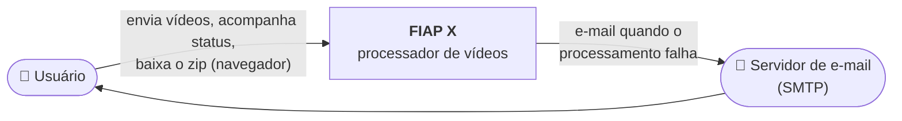
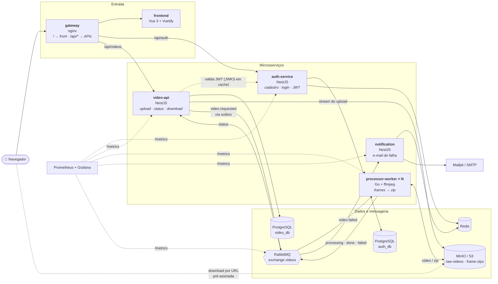
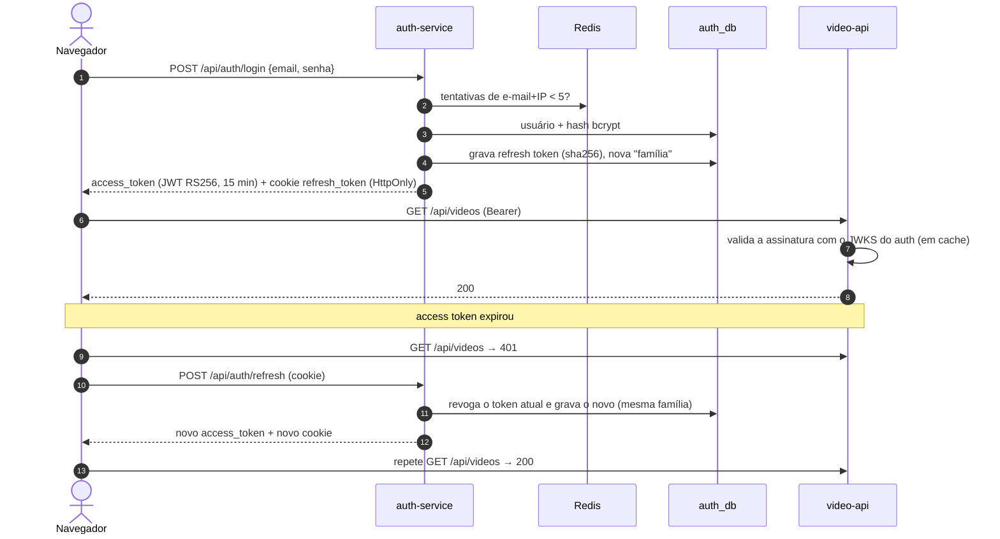
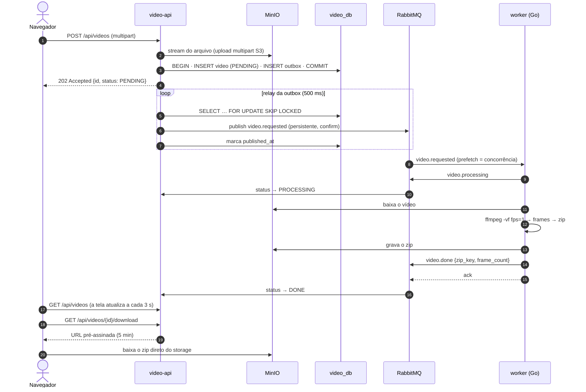
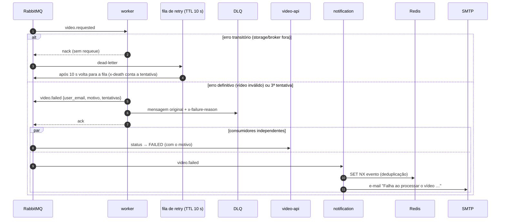
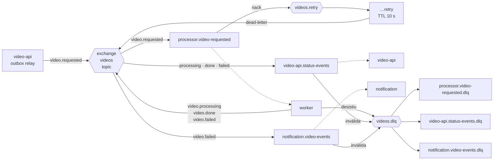
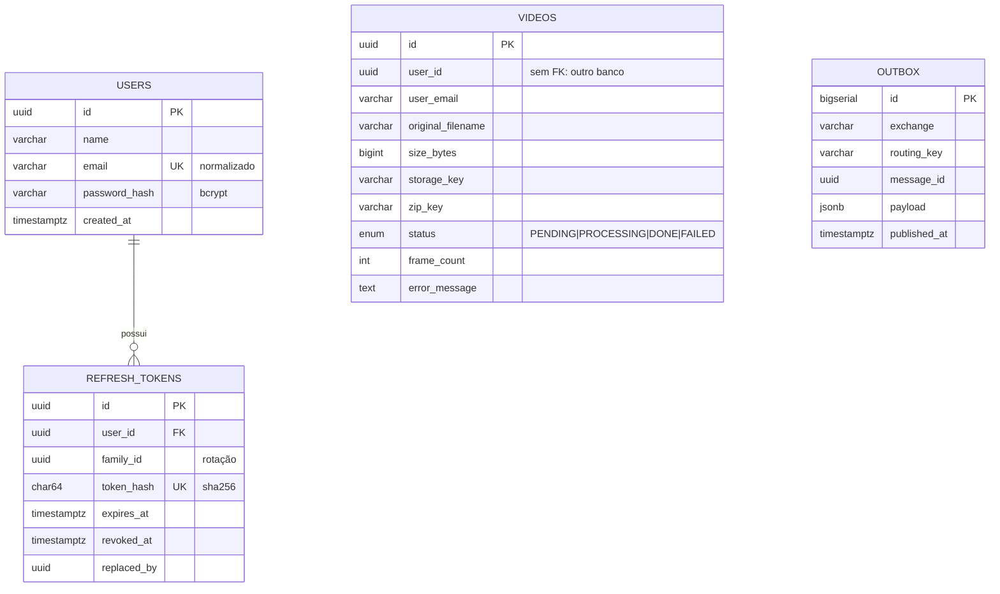
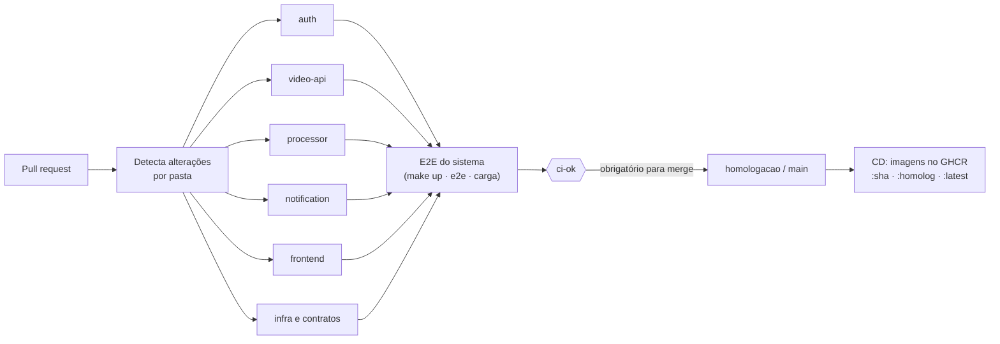

# Arquitetura — FIAP X

Documento de arquitetura do sistema de processamento de vídeos da FIAP X (Hackathon SOAT, Fase 5). O usuário envia vídeos e baixa um `.zip` com os frames extraídos (1 por segundo).

**Sumário**
1. [Contexto e requisitos](#1-contexto-e-requisitos)
2. [Visão geral (C4)](#2-visão-geral-c4)
3. [Serviços](#3-serviços)
4. [Fluxos principais](#4-fluxos-principais)
5. [Mensageria](#5-mensageria)
6. [Dados](#6-dados)
7. [Escalabilidade e resiliência](#7-escalabilidade-e-resiliência)
8. [Segurança](#8-segurança)
9. [Observabilidade](#9-observabilidade)
10. [Qualidade, CI/CD e fluxo de trabalho](#10-qualidade-cicd-e-fluxo-de-trabalho)
11. [Decisões (ADRs)](#11-decisões-adrs)
12. [Limitações e próximos passos](#12-limitações-e-próximos-passos)

---

## 1. Contexto e requisitos

O [projeto base](../legacy/main.go) era um monólito Go/Gin em um único arquivo. Ele processava o vídeo **dentro da requisição HTTP**, guardava tudo no disco local e não tinha autenticação, testes nem fila. A nova versão mantém a lógica de extração (ffmpeg + zip) e reorganiza o sistema em microsserviços.

| Requisito do PDF | Como foi atendido | Onde ver |
|---|---|---|
| Processar mais de um vídeo ao mesmo tempo | Worker em Go com N goroutines por réplica + várias réplicas na mesma fila | [processor](../services/processor), `make scale n=3` |
| Não perder requisição em picos | Upload persistido antes de responder; **outbox transacional**; filas duráveis; publisher confirms; ack manual; retry + DLQ | [video-api](../services/video-api), `make load` |
| Protegido por usuário e senha | auth-service: bcrypt, JWT RS256 de 15 min, refresh token rotativo em cookie HttpOnly, limite de tentativas de login | [auth](../services/auth) |
| Listagem de status dos vídeos do usuário | `GET /api/videos` com filtro, paginação e totais por status; tela atualiza sozinha | [video-api](../services/video-api), [frontend](../frontend) |
| Notificar o usuário em caso de erro | `video.failed` → notification-service → e-mail (Mailpit local), idempotente | [notification](../services/notification) |
| Persistir os dados | PostgreSQL (um banco por serviço), MinIO/S3 (arquivos), Redis | §6 |
| Arquitetura escalável | Serviços sem estado, fila desacoplando ingestão e processamento, réplicas do worker | §7 |
| Versionado no GitHub | Monorepo, branches `main` ⇒ `homologacao` ⇒ `feat/*` protegidas | §10 |
| Testes que garantam a qualidade | Unitários, integração com Testcontainers, E2E do sistema, carga (k6) | §10 |
| CI/CD | GitHub Actions: CI por serviço + E2E do sistema; CD publica imagens no GHCR | §10 |

**Stack** (a recomendada pelo PDF, em todos os itens): Docker + Docker Compose, RabbitMQ, PostgreSQL + Redis, Prometheus + Grafana, GitHub Actions.

---

## 2. Visão geral (C4)

### 2.1 Contexto

### 2.2 Containers

**Princípios**
- **Banco por serviço:** auth e video-api têm databases e usuários separados (o `auth_user` não consegue conectar no `video_db`). O worker e o notification não têm banco.
- **Comunicação por contrato:** HTTP descrito em [OpenAPI](../contracts/openapi) e mensagens descritas em [AsyncAPI](../contracts/asyncapi.yaml). Nenhum serviço importa código de outro.
- **Assíncrono onde demora:** a API só recebe e enfileira. O processamento pesado (ffmpeg) fica no worker, que escala separadamente.
- **Uma porta de entrada:** o gateway serve o front e a API na mesma origem. O cookie de refresh funciona sem CORS, e as rotas internas (`/health`, `/metrics`, JWKS) não ficam expostas.

---

## 3. Serviços

| Serviço | Responsabilidade | Stack | Dados | Escala |
|---|---|---|---|---|
| [auth-service](../services/auth) | Cadastro, login, emissão de JWT, refresh, logout, JWKS | Node 22, NestJS 11 | `auth_db`, Redis (limite de tentativas de login) | Sem estado, N réplicas |
| [video-api](../services/video-api) | Upload em streaming, outbox, listagem de status, download, consumo dos eventos de status | Node 22, NestJS 11 | `video_db`, MinIO | Sem estado, N réplicas |
| [processor-worker](../services/processor) | Extrai frames com ffmpeg, gera o zip e publica eventos | Go 1.27 | Só MinIO | N réplicas × concorrência |
| [notification](../services/notification) | E-mail quando o vídeo falha | Node 22, NestJS 11 | Redis (deduplicação) | N réplicas |
| [frontend](../frontend) | Interface web | Vue 3, Vuetify 3 | — | Arquivos estáticos (nginx) |
| gateway | Roteamento e porta única | nginx | — | — |

Todos os serviços de backend seguem **Clean Architecture / Hexagonal**:
- **`domain`:** regras puras;
- **`application` / `usecase`:** casos de uso e portas (interfaces);
- **`infrastructure` / `adapter`:** HTTP, banco, filas, storage, ffmpeg e SMTP.

Os casos de uso não conhecem framework nem banco e são testados com dublês em memória.

**Por que Go só no worker:** o desenvolvedor domina Node e .NET. A regra foi usar Go onde ele faz diferença ([ADR 0002](adr/0002-nestjs-nas-apis-e-go-no-worker.md)):
- reaproveita o código de ffmpeg do projeto base;
- goroutines tornam simples processar vários vídeos ao mesmo tempo;
- a imagem fica pequena (~150 MB com ffmpeg) e sobe rápido, o que ajuda a escalar.

---

## 4. Fluxos principais

### 4.1 Login e sessão

- O access token fica **só em memória** no front. Recarregar a página restaura a sessão pelo cookie.
- **Rotação com detecção de reuso:** se um refresh token já usado aparecer de novo (possível roubo), toda a família é revogada.
- A video-api **não chama o auth** a cada requisição: valida o JWT localmente com a chave pública.

### 4.2 Upload → processamento → download

### 4.3 Falha, retry e notificação

---

## 5. Mensageria

RabbitMQ 3.13, topologia versionada em [definitions.json](../infra/rabbitmq/definitions.json) e documentada em [asyncapi.yaml](../contracts/asyncapi.yaml).

| Garantia | Implementação |
|---|---|
| Mensagem não se perde no broker | Filas **quorum** duráveis + mensagens persistentes (`delivery_mode=2`) |
| Publicação confirmada | *Publisher confirms* nos dois lados (video-api e worker) |
| Consumo confirmado | `ack` manual **depois** do efeito concluído; se o worker cair, a mensagem volta para a fila |
| Upload aceito sem mensagem perdida | **Transactional outbox**: vídeo e mensagem gravados na mesma transação ([ADR 0004](adr/0004-transactional-outbox.md)) |
| Retry com espera | Fila de retry com TTL de 10 s, sem `sleep` no worker |
| Mensagens problemáticas | DLQ por consumidor, com o motivo |
| Entrega *at-least-once* | Consumidores **idempotentes**: o status nunca regride, o zip é sobrescrito e o e-mail é deduplicado no Redis |

---

## 6. Dados

**Scripts de criação** (entregável do PDF):
- [infra/db/init/01-create-databases.sh](../infra/db/init/01-create-databases.sh): cria um database e um usuário por serviço;
- [services/auth/migrations](../services/auth/migrations/001_init.sql) e [services/video-api/migrations](../services/video-api/migrations/001_init.sql): tabelas, aplicadas no boot com *advisory lock*;
- [infra/db/schema.sql](../infra/db/schema.sql): esquema consolidado, para referência;
- [infra/rabbitmq/definitions.json](../infra/rabbitmq/definitions.json) e [infra/minio/create-buckets.sh](../infra/minio/create-buckets.sh): filas e buckets.

`USERS` e `REFRESH_TOKENS` ficam no `auth_db`; `VIDEOS` e `OUTBOX` ficam no `video_db`.

| Armazenamento | O que guarda | Por quê |
|---|---|---|
| PostgreSQL 16 | Usuários, sessões, vídeos (metadados e status), outbox | Transações (outbox), consistência e consultas por usuário |
| MinIO (S3) | Vídeos enviados (`raw-videos`, expiram em 7 dias) e zips (`frame-zips`) | Arquivos grandes fora do banco; URL pré-assinada; trocar por AWS S3 é só configuração |
| Redis 7 | Tentativas de login (janela de 15 min) e deduplicação de e-mails | Estado efêmero compartilhado entre réplicas |

---

## 7. Escalabilidade e resiliência

- **Ingestão e processamento desacoplados:** a API responde `202` em milissegundos. Um pico de uploads vira fila, e a fila é drenada no ritmo dos workers.
- **Escala horizontal:** todos os serviços são sem estado. O worker escala com `make scale n=N` (num cluster, seria HPA/KEDA pelo tamanho da fila). Cada réplica processa `WORKER_CONCURRENCY` vídeos ao mesmo tempo.
- **Upload em streaming:** o vídeo vai do request direto para o S3 em partes de 8 MB, sem passar por memória nem disco. O limite de tamanho é verificado enquanto os bytes chegam.

| Falha | Comportamento |
|---|---|
| RabbitMQ fora | Uploads continuam aceitos (outbox); publicados quando o broker volta |
| Worker cai no meio de um vídeo | Sem `ack`, outra réplica reprocessa |
| Storage fora por alguns segundos | Retry após 10 s, até 3 tentativas |
| Vídeo corrompido | `FAILED` na hora (sem retry), e-mail ao usuário |
| ffmpeg travado | Timeout por vídeo (10 min) |
| SMTP fora | Mensagem volta para a fila; e-mail sai quando o SMTP voltar |
| Deploy do worker | Graceful shutdown: termina o vídeo em andamento |

**Medido** ([teste de carga](../tests/load/upload-burst.js)): 200 uploads simultâneos (40 usuários virtuais, 3 workers) → 100% aceitos, p95 de 193 ms no upload, fila drenada em cerca de 10 s, **200 concluídos e 0 perdidos**.

---

## 8. Segurança

- **Senhas:** bcrypt (cost 12), política mínima (8+ caracteres, letra e número, até 72 bytes), validada no front e no backend.
- **Tokens:**
  - access token JWT RS256 de 15 min; os outros serviços validam pelo JWKS;
  - refresh token opaco de 256 bits, guardado como sha256, em cookie `HttpOnly; SameSite=Strict; Path=/api/auth`, com rotação e detecção de reuso.
- **Força bruta:** 5 falhas por e-mail + IP a cada 15 min → `429` com `Retry-After`. As mensagens são genéricas, e há comparação de tempo constante para não revelar quais e-mails existem.
- **Isolamento:** cada usuário só vê os próprios vídeos. O vídeo de outro usuário responde `404`, não `403`.
- **Arquivos:**
  - a chave no bucket vem do ID, não do nome enviado, o que impede *path traversal* (presente no projeto base);
  - os buckets são privados, e o download é por URL pré-assinada de 5 min;
  - extensão e tamanho são validados.
- **Infra:** containers rodam como usuário não-root, a chave do JWT fica em *secret* (fora do git), as rotas internas não passam pelo gateway e há headers de segurança no nginx.
- **Cadeia de dependências:** `npm audit` (high) e `govulncheck` no CI. Vulnerabilidades encontradas durante o projeto foram tratadas: Prisma 6 trocado por `pg` e Nodemailer atualizado para a v10.

---

## 9. Observabilidade

- **Métricas:** todos os serviços expõem `/metrics` (Prometheus). As réplicas do worker são descobertas pelo DNS do compose, e o RabbitMQ expõe métricas por fila.
- **Dashboard** "FIAP X — Visão geral" no Grafana ([JSON provisionado](../infra/monitoring/grafana/dashboards/fiapx-overview.json)):
  - recebidos × concluídos × falhas e vazão;
  - fila do worker, outbox e DLQs;
  - workers ativos e tempo de processamento p50/p95;
  - latência e erros HTTP, logins e e-mails.
- **Logs:** JSON estruturado (Pino no Node, `slog` no Go), sem senha, token ou cookie. O `X-Request-Id` nasce no gateway e acompanha as mensagens (header `x-request-id`) até o worker.
- **Health checks:** `/health` em cada serviço verifica as dependências reais (banco, Redis, RabbitMQ, storage e SMTP) e é usado pelo `docker compose --wait`.

---

## 10. Qualidade, CI/CD e fluxo de trabalho

### Testes

| Nível | O que cobre | Ferramenta |
|---|---|---|
| Unitário | Domínio e casos de uso de cada serviço (gate de 80% de cobertura) | Jest, Go `testing` + testify, Vitest |
| Integração | Cada serviço com infraestrutura **real**: Postgres, Redis, RabbitMQ com a topologia do projeto, MinIO, Mailpit, ffmpeg | Testcontainers (Node e Go) |
| E2E do sistema | Stack completa pela porta da frente: login → upload → worker → zip; falha → e-mail; isolamento | `node:test` ([tests/e2e](../tests/e2e/system.test.mjs)) |
| Carga | Rajada de uploads sem perda | k6 ([tests/load](../tests/load/upload-burst.js)) |

### CI/CD (GitHub Actions)

- **Por serviço:** lint, typecheck, testes unitários e de integração, gate de cobertura, auditoria de dependências e build da imagem. Só roda o que mudou (*path filters*) e usa workflows reutilizáveis.
- **Infra:** `docker compose config`, `nginx -t`, `promtool`, `shellcheck` e validação dos contratos OpenAPI/AsyncAPI.
- **Branches:** `main` ⇒ `homologacao` ⇒ `feat/*`. `main` e `homologacao` são protegidas: exigem PR e o check `ci-ok`, e não aceitam push direto nem force push.

---

## 11. Decisões (ADRs)

| # | Decisão |
|---|---|
| [0001](adr/0001-monorepo.md) | Monorepo com serviços independentes (pronto para virar vários repositórios) |
| [0002](adr/0002-nestjs-nas-apis-e-go-no-worker.md) | NestJS nas APIs e Go só no worker |
| [0003](adr/0003-banco-por-servico-e-status-por-eventos.md) | Banco por serviço; o worker não tem banco e o status chega por eventos |
| [0004](adr/0004-transactional-outbox.md) | Transactional outbox para não perder uploads |
| [0005](adr/0005-rabbitmq.md) | RabbitMQ em vez de Kafka |
| [0006](adr/0006-armazenamento-s3.md) | Arquivos em S3/MinIO com URL pré-assinada |
| [0007](adr/0007-jwt-rs256-e-refresh-em-cookie.md) | JWT RS256 + refresh token rotativo em cookie HttpOnly |
| [0008](adr/0008-sql-puro-em-vez-de-orm.md) | `pg` + SQL puro em vez de Prisma |

---

## 12. Limitações e próximos passos

- **Kubernetes:** o PDF aceita Docker Compose, que é o que está em uso. O próximo passo seria publicar manifests com HPA para as APIs e KEDA para escalar o worker pelo tamanho da fila (`processor.video-requested`).
- **E-mail de falha tardia:** o notification confia no `video.failed`. Se uma falha chegar atrasada para um vídeo já `DONE` (raro: exige reentrega depois de sucesso), o e-mail sai mesmo assim. Evolução: a video-api publicar um evento só quando *aceita* a transição para `FAILED`.
- **MinIO:** a imagem pública do MinIO deixou de ser publicada em 2025. O projeto usa a última versão completa (Bitnami, congelada) só no ambiente local. Como o código usa a API S3 padrão, produção usaria AWS S3, R2 ou SeaweedFS, mudando só a configuração.
- **Atualização em tempo real:** hoje é polling a cada 3 s, só enquanto há vídeo ativo. Evolução: SSE ou WebSocket na video-api.
