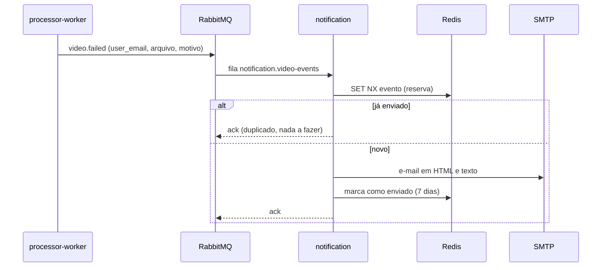

# notification-service

Avisa o usuário por e-mail quando o processamento de um vídeo falha. Atende ao requisito do PDF: *"Em caso de erro, um usuário pode ser notificado (e-mail ou outro meio de comunicação)"*. Contrato: evento `video.failed` em [asyncapi.yaml](../../contracts/asyncapi.yaml).

| | |
|---|---|
| Stack | Node 22 + NestJS 11 (TypeScript), Nodemailer |
| Porta | 3003 (`/health`, `/metrics`; não tem API pública) |
| Banco | Nenhum. A deduplicação fica no Redis |
| Entrada | Fila `notification.video-events` (binding `video.failed` na exchange `videos`) |
| Saída | E-mail via SMTP (Mailpit no ambiente local: http://localhost:8025) |

## Como funciona



O mesmo `video.failed` é consumido de forma independente pela video-api (que atualiza o status para `FAILED`) e por este serviço. Cada um tem a própria fila, então um não atrasa o outro.

| Situação | Comportamento |
|---|---|
| Evento entregue mais de uma vez | Um único e-mail (reserva com `SET NX` no Redis, compartilhada entre réplicas) |
| SMTP ou Redis fora do ar | A reserva é liberada e a mensagem volta para a fila; o e-mail sai quando o serviço voltar |
| Mensagem fora do contrato | Vai para a DLQ `notification.video-events.dlq` |
| Serviço fora do ar | As mensagens ficam na fila durável e são enviadas quando ele subir |

O nome do arquivo e o motivo do erro são escapados no HTML do e-mail.

## Testes

```bash
npm run test:cov   # caso de uso (envio, idempotência, falha de SMTP) e template
npm run test:e2e   # RabbitMQ (definitions.json real), Redis e Mailpit via Testcontainers
```

## Variáveis de ambiente

Ver [.env.example](.env.example). Em produção, basta apontar `SMTP_HOST`, `SMTP_PORT`, `SMTP_USER` e `SMTP_PASS` para qualquer provedor SMTP (SES, SendGrid, Gmail etc.).
