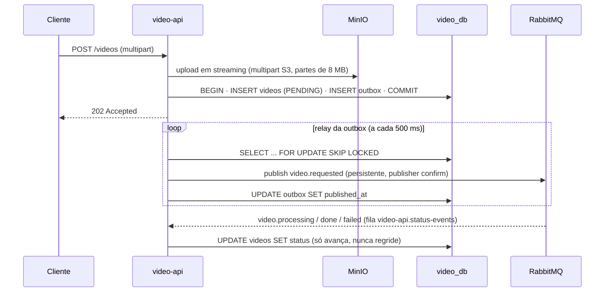

# video-api

Recebe os vídeos, enfileira o processamento, lista o status dos vídeos de cada usuário e entrega o zip de frames. Contratos: [videos.yaml](../../contracts/openapi/videos.yaml) (HTTP) e [asyncapi.yaml](../../contracts/asyncapi.yaml) (mensagens).

| | |
|---|---|
| Stack | Node 22 + NestJS 11 (TypeScript) |
| Porta | 3002 (pelo gateway: `/api/videos*`) |
| Banco | `video_db` (PostgreSQL, acessado só por este serviço) |
| Outras dependências | MinIO/S3 (arquivos), RabbitMQ (mensagens), JWKS do auth-service |

## Rotas

Todas exigem `Authorization: Bearer <access_token>` emitido pelo auth-service.

| Método | Rota | Descrição |
|---|---|---|
| POST | `/videos` | Upload multipart (campo `video`) → `202` com o vídeo `PENDING` (`400` formato, `413` tamanho) |
| GET | `/videos?status=&page=&page_size=` | Vídeos do usuário, mais recentes primeiro, com `total` e `counts` por status |
| GET | `/videos/{id}` | Detalhe (`404` se não existe ou é de outro usuário) |
| GET | `/videos/{id}/download` | URL pré-assinada do zip, válida por 5 min (`409` se ainda não está `DONE`) |
| GET | `/health`, `/metrics` | Infraestrutura *(não expostas pelo gateway)* |

## Como garante que nenhuma requisição se perde



- **Upload em streaming:** o vídeo vai do request direto para o S3 (`busboy` + `@aws-sdk/lib-storage`), sem passar por memória nem disco. O limite de tamanho é verificado enquanto os bytes chegam.
- **Outbox transacional:** o vídeo e a mensagem são gravados na mesma transação. Se o RabbitMQ estiver fora do ar, o upload continua sendo aceito e a mensagem é publicada quando ele voltar.
- **Publisher confirms + mensagens persistentes:** a mensagem só é marcada como publicada depois que o broker confirma o recebimento.
- **Consumidor idempotente:** eventos repetidos ou fora de ordem não fazem o status voltar atrás. Mensagens que não seguem o contrato vão para a DLQ, e erros transitórios voltam para a fila.
- **Falha no meio do upload:** o arquivo parcial é removido do bucket.

## Segurança

- O JWT é validado localmente com a chave pública do auth (JWKS em cache), sem chamar o auth a cada requisição.
- Cada usuário só acessa os próprios vídeos. O vídeo de outro usuário responde `404`, para não revelar que existe.
- A chave no bucket é `<user_id>/<video_id>.<ext>` e nunca vem do nome enviado, o que impede path traversal. O nome original é sanitizado.
- O download usa uma URL pré-assinada de curta duração, e os buckets são privados.

## Testes

```bash
npm run test:cov   # unitários: domínio e casos de uso (gate de 80%)
npm run test:e2e   # Postgres, RabbitMQ (topologia real do definitions.json) e MinIO via Testcontainers
```

## Variáveis de ambiente

Ver [.env.example](.env.example). `S3_PUBLIC_ENDPOINT` é o endereço que entra nas URLs de download, por isso precisa abrir no navegador.
